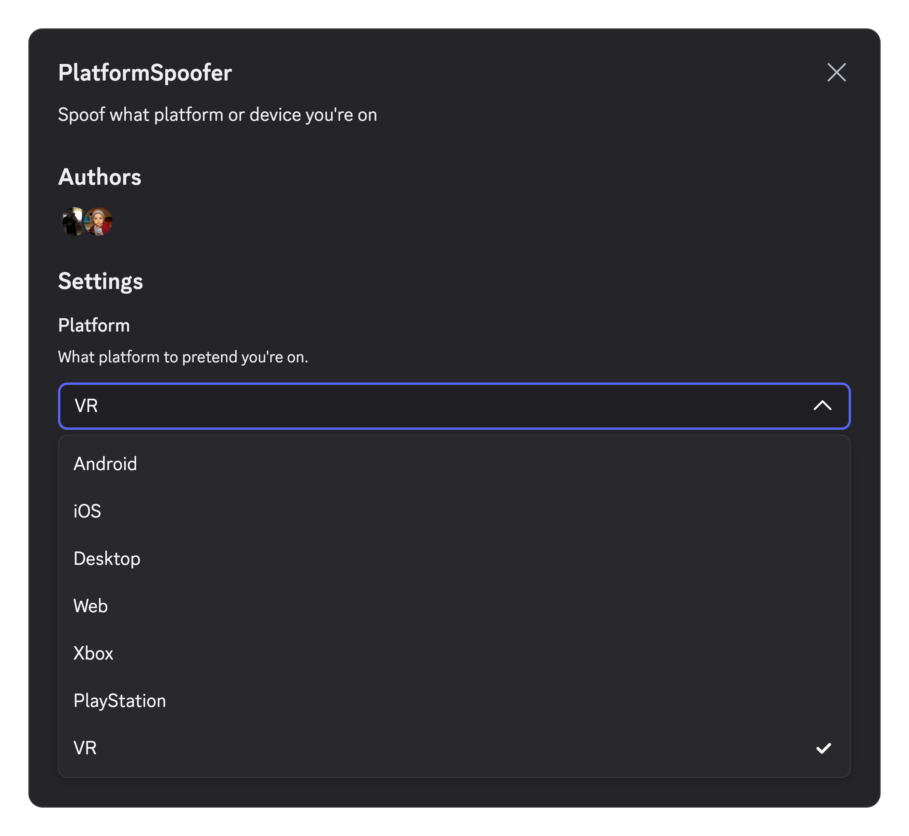

# PlatformSpoofer

An Equicord user plugin to appear on Android, iOS, Desktop, Web, Xbox, PlayStation, or VR.

  

## Credits

Based on (now removed) [Equicord’s PlatformSpoofer](https://github.com/Equicord/Equicord/tree/806beccf9b62febbd8772e534acb13195c4235b8/src/equicordplugins/platformSpoofer).

## License

This project is licensed under the GNU General Public License v3.0 or later. See [LICENSE](LICENSE) for details.

## Support

Make a GitHub issue if you find any bugs or have any questions, or preferably DM me on Discord `neoarz`.
 
If you find this project useful, consider leaving a star, would mean a lot!! ❤️
